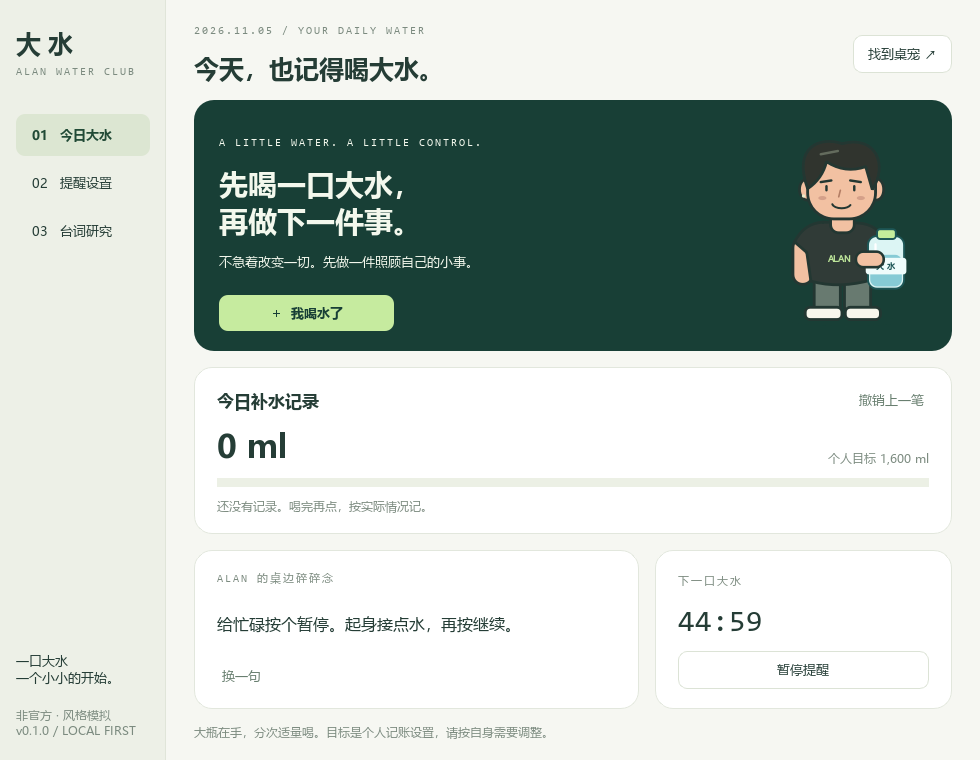
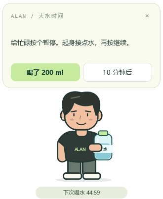

# 喝大水 · Alan Water Pet

邵艾伦风格的喝水提醒桌宠。把大水放在手边，照顾自己从一件小事开始。

**非官方项目。台词为基于截至 2026-10-15 公开内容的原创风格模拟，非本人原话；角色为原创卡通占位形象。**





## 现在能做什么

- Windows 透明置顶桌宠，拖拽、呼吸眨眼、举大水动画。
- 默认每 45 分钟提醒喝水；气泡中确认喝了，或延后 10 分钟。
- 分时段台词或随机闲聊，默认每 20 分钟一句，可关闭；支持自定义台词。
- 默认 23:00–08:00 免打扰；暂停/恢复提醒；托盘菜单、可选系统通知。
- 每次水量、个人记录目标、提醒间隔可调；今日记录、撤销上一笔、跨日自动统计。
- 本地保存，不需要 API Key，无后台网络请求。设置和记录位于 `%APPDATA%\AlanWaterPet\`。
- 单实例保护，睡眠唤醒后最多提醒一次，不堆积补发。

桌宠：**拖动**搬家，**点击**换一句，**双击**打开面板，**右键**打开菜单。关闭面板后继续驻留托盘，通过托盘的“退出”完全结束。未检测到系统托盘时，关闭主面板会退出应用。

## Windows 使用

下载 [Releases](https://github.com/1saachen/shao-alan-water-pet/releases) 中的 Windows x64 zip，**完整解压整个目录**后运行 `AlanWaterPet.exe`。不要单独移走 exe；旁边的 `_internal` 包含 Qt 运行库。程序尚未做代码签名。

## 从源码运行

需要 Python 3.11+，推荐 3.12，Windows 10/11 x64。

```powershell
git clone https://github.com/1saachen/shao-alan-water-pet.git
cd shao-alan-water-pet
python -m venv .venv
.\.venv\Scripts\python.exe -m pip install -r requirements.txt
.\.venv\Scripts\python.exe main.py
```

仅显示桌宠：`python main.py --pet-only`。本地已有环境也可运行 `scripts/run.ps1`。首次启动默认打开今日面板，便于修改提醒时间。应用不会自动设置开机启动。

## 一些台词

> 理论可以研究很久，瓶盖只要拧一下。先喝大水，对吧？

> 把水放在手边，是在给自己降低行动的 cost。现在喝两口。

> 你可以暂时没想清楚下一步。先做一件确定的事：喝口水。

> 今天到这里也可以。能主动结束一天，也是一种控制权。

“大水”在这里指大瓶放在手边、分次适量喝。200 ml 是可修改的记账单位，1600 ml 是可修改的个人记录目标，不是每日总摄入处方。无需为完成进度硬喝；有液体摄入限制时按医嘱使用。

## 为什么这样做

先检索了 [water-reminder-desktop-pet](https://github.com/arthghori/water-reminder-desktop-pet)、[desktop-pet](https://github.com/Dametime-0/desktop-pet)、[PawPal](https://github.com/zebangeth/PawPal)，选择 PySide6 独立实现。研究了用户指定的 [shao-alan-skill](https://github.com/Roc-Dove/shao-alan-skill) 和相关网络内容，采用口语化、低频英文、控制权主题和单一行动落点。

大水理论的传播语境与邵艾伦的表达模型分开：它们可以作为桌宠创意融合，不能把别人的梗冒充本人原话。详情见 [研究与来源](docs/research.md)、[第三方声明](THIRD_PARTY_NOTICES.md)。

## 开发、检查与打包

```powershell
.\.venv\Scripts\python.exe -m pip install -r requirements-dev.txt
.\.venv\Scripts\python.exe -m unittest discover -s tests -v
.\.venv\Scripts\python.exe main.py --preview-dir artifacts
.\scripts\build.ps1
```

预览命令生成面板、桌宠、设置和台词页 PNG，并使用独立数据目录，不改动个人记录。便携包输出到 `dist/AlanWaterPet-0.1.0-windows-x64.zip`。GitHub Actions 同步测试并构建 Windows artifact。

```text
alan_water_pet/core.py     时间调度、本地状态和台词选择
alan_water_pet/quotes.json 原创台词库
alan_water_pet/art.py      原创程序绘制角色和动画
alan_water_pet/ui.py       透明桌宠与三个控制面板
alan_water_pet/app.py      托盘与应用生命周期
docs/research.md          项目参考、证据与设计取舍
```

当前版本以 Windows 为验证目标，macOS/Linux 尚未验证。暂不包含真人语音、在线聊天、授权真人素材或开机启动配置。MIT（依赖按各自许可分发）。
